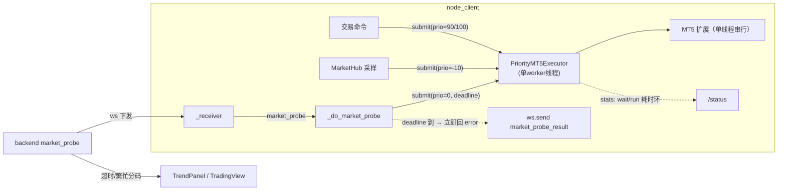

# 行情探针（trend 面板）提速方案 — 节点侧解耦 + 错误语义 + 可观测性

| 项目 | 说明 |
| --- | --- |
| 文档版本 | v1.0（2026-11-25） |
| 编写日期 | 2026-11-25 |
| 状态 | **方案待评审**（P0~P5 分阶段，见 §13；未写代码） |
| 适用范围 | 节点端 `node_client/`、后端 `backend/app/market_probe.py` / `trend_api.py` / `config_api.py` / `system_settings.py`、前端 `frontend/src/components/TrendPanel.vue` / `views/TradingView.vue` |
| 关联文档 | [多节点开仓同时性优化方案.md](./多节点开仓同时性优化方案.md) §M1（优先级执行器）、§M8（时延埋点）；[技术实现方案.md](./技术实现方案.md) 第 6 章 `/ws/node` 协议 |

> **一句话定位**：线上 `GET /api/nodes/{node_id}/trend` 间歇性 `409 节点未在超时时间内返回行情`，
> 根因是**节点侧所有 MT5 调用挤在同一个单线程执行器里排队**，探针排在队尾被饿死。
> 本方案把探针从黑盒超时变成**「排队等多久 / 执行多久 / 为什么失败」都可解释**，不改交易语义。

---

## 目录

1. [问题与实测证据](#1-问题与实测证据)
2. [根因链路](#2-根因链路)
3. [目标与非目标](#3-目标与非目标)
4. [方案总览](#4-方案总览)
5. [P0 可观测性（先看得到）](#5-p0-可观测性先看得到)
6. [P1 探针快速失败（止血）](#6-p1-探针快速失败止血)
7. [P2 优先级串行执行器](#7-p2-优先级串行执行器)
8. [P3 压缩一次探针的 MT5 调用](#8-p3-压缩一次探针的-mt5-调用)
9. [P4 后端错误语义与超时可配](#9-p4-后端错误语义与超时可配)
10. [P5 前端减少无效轮询](#10-p5-前端减少无效轮询)
11. [配置项汇总](#11-配置项汇总)
12. [测试方案](#12-测试方案)
13. [分阶段落地计划](#13-分阶段落地计划)
14. [风险、边界与明确不做的事](#14-风险边界与明确不做的事)
15. [待确认事项](#15-待确认事项)

---

## 1. 问题与实测证据

### 1.1 现象

线上（2026-11-25 13:24~13:47 实测）`GET http://159.75.33.185/api/nodes/nd_051dc3891b7437e0/trend?symbol=XAUUSD`：

```text
HTTP/1.1 409 Conflict
{"detail":"节点未在超时时间内返回行情"}
```

耗时恒为 **8.2~8.4s**（后端 `RPC_TIMEOUT = 8.0` 打满）。

### 1.2 实测关键结论（可复现）

| # | 观测 | 结论 |
| --- | --- | --- |
| 1 | 节点 `status: online`、`mt5_link: online`、`last_seen` 实时更新；账户快照每 5s 正常上报 | 节点进程与 WS 通道健康 |
| 2 | 不存在品种（`GOLD` / `XAUEUR` / `XAUAUD`）**0.3~0.4s** 就回明确错误「无可用 K 线」 | 节点接收与回包链路正常，**慢只发生在真正读 K 线的调用上** |
| 3 | 同一参数（`bars=50`，缓存键相同）**连续 5 次全部 8.3s 超时** | 不是抖动；是一段持续期内节点侧该查询**整段被堵住** |
| 4 | 失败**成簇出现**，间隔 2~5 分钟；静置后恢复（`XAU 0.02s / EUR 0.6s / XAG 1.0s`） | 与「终端补历史 / 链路波动 / 采样高峰」这类**周期性重活**相关 |
| 5 | 并发 8 个不同 `bars` 请求（穿透 2s 缓存）全部 409 | 后端在途合并只在缓存键相同时生效；参数微调会放大终端压力 |
| 6 | 同样的失败模型下 `EURUSD` 也会 409，但总体比 `XAUUSD` 更容易成功 | 全局排队问题，XAUUSD 因是主策略交易品种叠加更多调用而更突出 |

### 1.3 本次不做的事（已排除）

- 不是 401/403：带 JWT 可正常打到节点，失败统一 409；
- 不是品种代码错：同符号在节点空闲时 200；
- 不是「后端 8s 太短造成的假失败」：节点侧连同缓存键重复请求也全部超时；
- 不是 nginx / CORS：409 是后端等满超时后主动返回的。

---

## 2. 根因链路

### 2.1 请求全链路

```text
GET /api/nodes/{node_id}/trend
 └─ trend_api.node_trend                       # 鉴权 + 参数归一
     └─ market_probe.fetch(node, sym, tf, n)   # 2s 缓存 + 在途合并（缓存键含 bars）
         └─ market_probe._request              # ws 下发 {"cmd":"market_probe", req_id}
             └─ manager.send_to_node            # connections.py:72
                 └─ WebSocket → node_client
                     └─ _receiver → _handle     # market_probe 用 create_task 派生（不阻塞接收）
                         └─ _do_market_probe    # node_client.py:1597
                             ├─ _exec(mt5.closed_bars)        # ① 可能卡在这里
                             ├─ _exec(mt5.quotes)             # ② 同一单线程串行
                             └─ _probe_symbol_spec()          # ③ 第三次串行
```

### 2.2 三个结构性放大因素

#### (a) 单线程执行器是所有 MT5 调用的唯一入口

```122:126:node_client/node_client.py
        # MT5 的 Python API 非线程安全：所有阻塞调用固定在这一个线程里排队，
        # 否则风控清仓与策略收口会并发对同一批持仓发单，后到的那笔必被拒
        self._mt5_executor = ThreadPoolExecutor(max_workers=1, thread_name_prefix="mt5")
```

**这个设计本身是对的**（MT5 扩展要求同线程串行）。问题在于**排队没有优先级**，
谁先提交谁先执行——探针和心跳级快照、秒级账本探测、0.5s 一轮的策略采样公平排队。

#### (b) 探针只有「整体超时」，没有「排队超时」

`market_probe.RPC_TIMEOUT = 8.0` 覆盖了「传输 + 排队 + 执行」三段，但后端无法区分。
节点侧 `_do_market_probe` 排到队尾后，只能干等，没有「我已经等了 3 秒，先给个明确报错」的机制。

#### (c) 一次趋势请求串行打 3 条 MT5 调用

`closed_bars` → `quotes` → `symbol_spec`，每条都要重新排队。而 `symbol_spec` 与 `quotes` 读的是同一个
`symbol_info`，可以合并。

### 2.3 同一终端上的固定调用负荷（排队来源）

| 协程 | 间隔 | MT5 调用 | 优先级建议 |
| --- | --- | --- | --- |
| `_reporter` | 5s | `positions` / `orders` / `quotes` / `account_info` | 0 |
| `_books_watch` | 1s | `orders`（变了再打一份完整快照） | 0 |
| `_link_monitor` | 1s | `terminal_info` | 0 |
| MarketHub `sample()` | 0.5s（有订阅时） | `positions` / `orders` / `quotes` / `symbol_info` | -10 |
| `_deals_reporter` | 60s | `history_deals`（可一次拉很多） | -10 |
| 交易命令 | 事件驱动 | `order_send` / `close` / `modify` | 100 / 90 / 50 |
| **`market_probe`** | 按需 | `closed_bars` / `quotes` / `symbol_info` | **0（独立超时）** |

> 注：`_do_market_probe` 当前没有任何「同 symbol 合并」；同一时刻两个页面看同一品种，
> 会在节点侧产生两条独立探针（后端 2s 缓存只能挡住大部分）。

---

## 3. 目标与非目标

### 3.1 目标

1. **可用性**：趋势面板在节点繁忙时**秒级返回明确原因**（「节点繁忙，请稍后重试」），而不是 8s 后超时；
2. **可观测**：能区分「排队等待超过阈值」与「单次查询慢」，线上直接看到 `exec_wait_ms` / `exec_run_ms`；
3. **不劣化交易链路**：任何改动都不能降低开仓/平仓的时延保证（参照 M1 的优先级设计）；
4. **兼容**：旧节点 / 旧前端在灰度期可并存（新字段可选，缺省走旧行为）。

### 3.2 非目标（本次不做）

- **不拆多进程**（「一个进程开仓、一个进程读历史、一个进程读行情」）：会同时推翻「`node_id` 单连接」
  「快照幂等」「风控状态机同进程时序」三条既有约束，收益不匹配风险。详见
  [关联讨论] 结论：先做进程内优先级，若终极端 IPC 成为新瓶颈，再评估「只拆只读 reader 进程」。
- **不改 `/ws/node` 协议主结构**：只在 `market_probe_result.data` 里**新增可选字段**；
- **不改趋势算法**：`trend_indicators.py` 不动。

---

## 4. 方案总览



| 阶段 | 改造项 | 解决问题 | 改动面 |
| --- | --- | --- | --- |
| **P0** | 探针耗时埋点（`/status` + 回包字段） | 盲区（先量出来再改） | node_client 小 |
| **P1** | 探针**排队超时**（deadline 快速失败） | 8s 黑盒超时 → 1~2s 明确报错 | node_client 小，**不动后端** |
| **P2** | 优先级串行执行器（M1 落地） | 探针/采样不再挡住交易 | node_client 中 |
| **P3** | 合并 `symbol_spec` + `quotes` | 单探针 MT5 调用 3→2 | node_client 小 |
| **P4** | 后端 `RPC_TIMEOUT` 可配 + 错误分码 | 用户看到可行动的原因 | backend 小 |
| **P5** | 前端轮询降噪 | 减少峰值（非根因） | frontend 小 |

> **顺序**：P0 → P1 → P2 必须按序（先可观测，再止血，再根治）；P3/P4/P5 可并行。

---

## 5. P0 可观测性（先看得到）

### 5.1 探针统计环形缓冲（节点侧新增模块）

新增 `node_client/probe_stats.py`：进程级、线程安全、固定容量（默认 200 条）。

```python
@dataclass(frozen=True)
class ProbeSample:
    ts: float          # 完成时刻
    symbol: str
    timeframe: str
    count: int
    recv_at: float     # 命令到达节点（_handle 内补）
    submitted_at: float# 提交给执行器时刻
    started_at: float  # 真正开始执行时刻
    finished_at: float
    ok: bool
    error: str | None
    phase: str         # "cache_hit" | "queue_timeout" | "exec" | "wait_timeout"

    @property
    def exec_wait_ms(self) -> float:   # started_at - submitted_at
        ...
    @property
    def exec_run_ms(self) -> float:    # finished_at - started_at
        ...
    @property
    def total_ms(self) -> float:       # finished_at - recv_at
        ...
```

聚合输出（给 `/status`）：

```json
{
  "market_probe": {
    "window": 200,
    "ok": 171, "queue_timeout": 12, "wait_timeout": 9, "exec_error": 8,
    "p50_ms": 212, "p95_ms": 1240, "max_ms": 8210,
    "exec_wait": {"p50_ms": 22, "p95_ms": 340, "max_ms": 7900},
    "exec_run": {"p50_ms": 190, "p95_ms": 640, "max_ms": 2300},
    "last_errors": [
      {"ts": 1795584200.1, "symbol": "XAUUSD", "phase": "queue_timeout",
       "exec_wait_ms": 2001, "error": "节点繁忙：探针排队超时"}
    ]
  }
}
```

### 5.2 回包字段（`market_probe_result.data` 新增可选字段）

```json
{
  "req_id": "…",
  "symbol": "XAUUSD",
  "timeframe": "M30",
  "bars": [...], "quote": {...}, "spec": {...},
  "probe_metrics": {
    "recv_at": 1795584200.0,
    "submitted_at": 1795584200.001,
    "started_at": 1795584200.023,
    "finished_at": 1795584200.241,
    "exec_wait_ms": 22.1,
    "exec_run_ms": 218.4
  }
}
```

> 后端 `market_probe._request` 原样透传或按需截断；后端不做聚合（后端已经有自己的
> `fetched_at`），**节点侧 `/status` 才是权威耗时来源**。

### 5.3 本机状态口

`local_status.py` 的 `GET /status` 里增加 `market_probe` 字段（`/health` 不加，保持轻量）。
`nr status` / 运维面板读 `127.0.0.1:{local_status_port}/status` 即可。

### 5.4 验收

- 压测 10 分钟：能从 `/status` 直接区分「`queue_timeout` 多」还是「`exec_run` 长」；
- 线上复现一次 409 后，`last_errors` 立即定位到具体相。

---

## 6. P1 探针快速失败（止血）

### 6.1 核心思路

**不引入优先级（那是 P2），只给探针一个「排队截止时间」**：

1. `_do_market_probe` 在提交 `closed_bars` 前记录 `deadline = now + PROBE_QUEUE_DEADLINE`（默认 **2.0s**，可配置）；
2. 提交到 `_mt5_executor` 后，在事件循环里 `await asyncio.wait_for(fut, timeout=PROBE_QUEUE_DEADLINE)`；
3. 超时 → **不取消执行器任务**（MT5 调用不可中断，取消会破坏单线程语义），
   而是立刻回 `{"error": "节点繁忙：行情探针排队超时", "busy": true, "phase": "queue_timeout"}`；
4. 被放弃的执行结果由回调丢弃并计入 `probe_stats`（`phase="queue_timeout"`）。

> 这样后端不用等 8s，**用户 2s 内就能看到「繁忙，请重试」**；而执行器里的那个查询照旧跑完，
> 不会造成「取消了一半的 IPC 调用」。

### 6.2 为什么不在执行器内部取消

MT5 扩展调用是**同步不可中断**的。从 asyncio 侧 `future.cancel()` 只能让上层等待者放弃，
底层线程仍在跑。若此时把该线程「标记为可复用」，就会在**同一个线程里开着两次 MT5 调用**，
违反 MT5 的线程安全硬约束。因此：**放弃等待，但不取消执行** 是唯一安全做法。

### 6.3 与 8s 后端超时的关系

| 后端 `RPC_TIMEOUT` | 节点 `PROBE_QUEUE_DEADLINE` | 用户体验 |
| --- | --- | --- |
| 8s（现状） | 2s | 2s 内拿到「繁忙」，重试一次可能命中（P1 后默认行为） |
| 8s | 8s（等于不启用） | 退回现状 |
| 8s | 0（关闭） | 退回现状 |

### 6.4 需同时补齐的「迟到结果」处理

当前 `market_probe._pending.pop()` 已经在超时后清理，**迟到包会被丢弃**（安全）。
但要新增：节点侧 `/status` 记一条 `phase="wait_timeout"`，便于判断
「后端等 8s 都没收到节点回包」——说明 **WS 回程也异常**，而不只是终端慢。

### 6.5 配置

```env
PROBE_QUEUE_DEADLINE=2.0   # 秒；0 = 关闭快速失败，负数非法，回落 2.0
```

### 6.6 验收

- 复现 §1.2 第 3 条（堵塞期连打 5 次）：预期 5 次均 ≤2.2s 返回「繁忙」，而不是 8s 超时；
- 节点侧 `/status.market_probe.queue_timeout` 计数与线上请求次数一致。

---

## 7. P2 优先级串行执行器

> 直接落地 [多节点开仓同时性优化方案.md](./多节点开仓同时性优化方案.md) §M1，**只在节点侧**。
> M1 关注的是「开仓插队」，本方案关注的是「探针不被采样饿死」，**共用同一个执行器**。

### 7.1 新增 `node_client/mt5_queue.py`

```python
class PriorityMT5Executor:
    """单线程 + 优先级的串行执行器。

    - 仍然只有一个 worker 线程：MT5 扩展非线程安全的硬约束不变；
    - 优先级让「开仓」插到「采样」前面；同优先级内 FIFO；
    - 支持 deadline：排队超时先给调用方一个 Busy 错误，但不取消执行；
    - 每次执行记录 wait/run 耗时，喂给 probe_stats。
    """

    async def submit(self, fn, *args,
                     priority: int = 0,
                     deadline: float | None = None) -> Any: ...

    def submit_low(self, fn, *args, **kwargs) -> Awaitable[Any]:
        # 采样 / 采集专用：-10
```

### 7.2 优先级表

| 优先级 | 用途 | 调用点 |
| --- | --- | --- |
| **100** | 开仓（市价 / 限价） | `_do_open`、`_open_first`、`_risk_send_order` |
| **90** | 平仓 | `_do_close`、`_close_all`、`_execute_risk_close` |
| **50** | 撤单 / 改单 | `_cancel_counter_orders`、`modify_position_sl` |
| **0** | 账户快照 / 成交采集 / **`market_probe`** | `_snapshot`、`_collect_deals`、`_do_market_probe` |
| **-10** | MarketHub 采样 / 历史成交采集 | `market_hub.py` 的 `_exec`、`_deals_reporter` |

### 7.3 饥饿保护

- 采样是周期任务，**不依赖事件到达**，饿几拍无大碍；
- 但探针与快照**不能无限饿**：给它们一个「最多被连续插队 N 次后提升到 +5」的规则（N 默认 3）；
- 交易链路不做任何提升（它们本来就该无条件优先）。

### 7.4 兼容性

- `NodeClient._exec(fn, *args)` 保持**原签名**，内部默认 `priority=0`；
- 关键路径（交易）显式传 `priority=`；其它位置不动，行为不变。

### 7.5 验收

| 指标 | P1 后 | P2 后（目标） |
| --- | --- | --- |
| 采样高峰期探针 `queue_timeout` 次数 | 有 | 显著下降 |
| 开仓命令排队等待 p95 | 不变（未做 P2 时，也可能被采样堵住） | 下降（同 M1 验收口径） |
| 探针 `exec_wait.p95` | — | < 100ms |

---

## 8. P3 压缩一次探针的 MT5 调用

### 8.1 现状

```1597:1634:node_client/node_client.py
        else:
            try:
                bars = await self._exec(self.mt5.closed_bars, symbol, timeframe, count)
                quotes = await self._exec(self.mt5.quotes, [symbol])
            except Exception as e:  # noqa: BLE001
                ...
            else:
                ...
                    data["bars"] = bars
                    data["quote"] = (quotes or {}).get(symbol) or {}
                    spec = await self._probe_symbol_spec(symbol)   # ← 第 3 次
```

`symbol_spec()` 与 `quotes()` 读的都是 `mt5.symbol_info(resolved)`，可以一次拿到。

### 8.2 改法

1. 在 `mt5_client.py` 新增：

   ```python
   def quote_with_spec(self, symbol: str) -> tuple[dict, dict]:
       """一次 symbol_info + 一次 symbol_info_tick：同时返回报价与合约规格。

       合并 reasons：趋势面板一次探针原先要 3 条 MT5 调用（bars / quotes / spec），
       这里把后两条压成 1 条，降低单线程串行占用 1/3。
       """
   ```

2. `_do_market_probe` 改为：`bars` → `quote_with_spec`，共 **2 次** `_exec`；
3. **保留** `_probe_symbol_spec` 作为兜底（`quote_with_spec` 失败时再单独取一次，与现状同）；
4. 回包字段不变（`quote` + `spec` 都在），**老后端/老前端零感知**。

### 8.3 附带收益

- `_snapshot` 里的 `quotes()` + 后续可能用到的 `symbol_point()` 也能顺带吃到 `spec`；
  但 `_snapshot` 不在本方案范围内，先不动。

### 8.4 验收

- 单个探针的 `exec_run_ms` 中位数下降 ≈ 1/3；
- `probe_stats` 里 `phase="exec"` 的 `finished_at - started_at` 减少。

---

## 9. P4 后端错误语义与超时可配

### 9.1 `RPC_TIMEOUT` 可配置

- `backend/app/market_probe.py`：

  ```python
  RPC_TIMEOUT = float(os.getenv("MARKET_PROBE_RPC_TIMEOUT", "8.0"))
  ```

- `.env.example` 增加 `MARKET_PROBE_RPC_TIMEOUT=8.0`；
- 校验：`< 1.0` 或 `> 30.0` 视为非法，回落 8.0 并 `logger.warning`。

### 9.2 错误分码

```python
class ProbeError(RuntimeError):
    """探针取数失败。code 用于前端/面板做可行动提示。"""

    def __init__(self, message: str, *, code: str = "probe_failed", retryable: bool = False):
        super().__init__(message)
        self.code = code
        self.retryable = retryable
```

| 场景 | 节点侧 error | 后端 `detail` 示例 | `code` | 前端提示 |
| --- | --- | --- | --- | --- |
| 节点离线 | `send_to_node` 返回 False | `节点当前离线，无法读取行情` | `node_offline` | 检查节点连接 |
| 节点排队超时（P1） | `节点繁忙：行情探针排队超时` | 原样透传 | `node_busy` | 「节点繁忙，请重试」（可自动重试 1 次） |
| 后端 8s 仍未收到回包 | — | `节点未在超时时间内返回行情` | `rpc_timeout` | 「节点响应超时」 |
| 品种无 K 线 | `XAUUSD M30 无可用 K 线` | 原样透传 | `no_bars` | 检查品种 / 周期 |
| 终端读取失败 | `读取行情失败：…` | 原样透传 | `terminal_error` | 检查终端状态 |

### 9.3 返回结构（保持向后兼容）

```json
// 现状：409 + {"detail": "..."}
// P4：409 + {"detail": "...", "code": "node_busy", "retryable": true}
```

`TrendPanel` 读取 `code` 做差异化展示；旧前端仍读 `detail`，行为不变。

### 9.4 纳入趋势风控闸门

`group_dispatcher._trend_risk_block` 目前把 `ProbeError` 一律转成「趋势风控：读取行情失败」，
**在 P4 后需要区分**：`node_busy` / `rpc_timeout` 属于**可重试**，
不应直接当作拦截理由（现行为是 fail-closed 拦开仓，会误伤）。

> ⚠️ 这是**业务行为变更**：见 §14 风险表与 §15 待确认 Q3。

---

## 10. P5 前端减少无效轮询

| 位置 | 现状 | 改法 |
| --- | --- | --- |
| `TrendPanel.vue` | `refreshMs` 默认 15s，`reloadSoon` 在参数调整时额外触发 | 默认间隔改为 **20s**；`reloadSoon` 合并到当前轮询周期内的下一次（不再额外打一次） |
| `TrendPanel.vue` | 品种切换时立即发起 | 保持；但若同一品种 2s 内已成功，直接复用（后端 2s 缓存仍可挡） |
| `TradingView.vue` | `TREND_POLL_MS = 15000`，与 `TrendPanel` 同时活跃时叠加 | 两个组件共用全局单例轮询（Pinia store 中统一管理，同一 `node_id+symbol+tf` 只有一个 in-flight） |
| 请求失败 | 无退避；下一周期照旧打 | 连续失败 3 次后指数退避（最多 60s），成功一次恢复 |

### 10.1 不做的

- **不做客户端本地缓存 K 线**：后端 2s 缓存 + P1 快速失败已经够用；
- **不改趋势参数**：属产品配置，不在本方案范围。

---

## 11. 配置项汇总

| 配置 | 位置 | 默认 | 说明 |
| --- | --- | --- | --- |
| `PROBE_QUEUE_DEADLINE` | 节点 `.env` | `2.0` | 探针排队截止时间（秒），0 = 关闭 |
| `PROBE_STATS_WINDOW` | 节点 `.env` | `200` | `/status` 聚合窗口条数 |
| `MARKET_PROBE_RPC_TIMEOUT` | 后端 `.env` | `8.0` | 后端等待节点回包的总超时 |
| `trend.refreshMs` 默认值 | 前端常量 | `15000`（→ `20000`） | TrendPanel 轮询间隔 |
| `TREND_POLL_MS` | `TradingView.vue` | `15000` | 与 TrendPanel 共用后改为读 store 配置 |

---

## 12. 测试方案

### 12.1 单测（node_client）

- `test_mt5_queue.py`
  - 同优先级 FIFO；
  - 高优先级插队（100 在 0 之前）；
  - deadline 超时返回 `BusyError`，且**执行器内任务仍会完成**（用 mock 计数器验证）；
  - wait/run 耗时字段正确。
- `test_probe_stats.py`
  - 环形缓冲容量、p50/p95 计算、`last_errors` 截断。
- `test_market_probe_metrics.py`
  - 回包带 `probe_metrics`，字段类型正确。

### 12.2 单测（backend）

- `test_market_probe_timeout.py`
  - 节点回 `busy=true` → 409 + `code=node_busy` + `retryable=true`；
  - 8s 无回包 → 409 + `code=rpc_timeout`；
  - 旧节点（无 `busy` 字段）→ 保持现有 `detail` 文本。
- `test_group_dispatch_trend_busy.py`
  - `node_busy` 时**不拦开仓**（或按 Q3 决策），且落一条 `skipped` 审计。

### 12.3 集成 / 压测

- 节点空闲压测：100 个不同 `bars` 的 XAUUSD 探针，`queue_timeout` = 0，`exec_run` p95 < 1s；
- 节点繁忙压测：Mock 一个 1.5s 的 `closed_bars` + 0.5s 采样，连续探针全部命中 `queue_timeout`，
  且**不能出现 `exec_run` 仍在跑时又来一次 `closed_bars`**（单线程语义验证）；
- 线上灰度：先上一台节点，观察 `/status.market_probe` 7 天。

### 12.4 回归必跑

- `backend/tests/test_trend_panel.py`；
- `backend/tests/test_grid_sizing.py`（共用 `market_probe` 探针）；
- `backend/tests/test_group_api.py` 中的趋势风控用例；
- `node_client/test_node_client.py` 的 `test_market_probe_*` 全部。

---

## 13. 分阶段落地计划

| 阶段 | 内容 | 工作量估计 | 依赖 | 风险 |
| --- | --- | --- | --- | --- |
| **P0** | 探针耗时埋点 + `/status` | 0.5 天 | 无 | 极低（纯新增） |
| **P1** | 探针排队截止时间 | 0.5~1 天 | P0 | 低（不改交易路径） |
| **P2** | `PriorityMT5Executor`（M1） | 2~3 天 | P0/P1 | 中（首次动交易路径的排队顺序，需回归） |
| **P3** | `quote_with_spec` 合并 | 0.5 天 | 无 | 低（回包字段不变） |
| **P4** | 后端超时可配 + 分码 | 0.5~1 天 | P1 | 中（趋势风控语义变更，见 Q3） |
| **P5** | 前端轮询降噪 | 0.5 天 | 无 | 低 |

**上线顺序建议**：P0 → P1 → （观察 2~3 天）→ P2 → P3 → P4 → P5。

**回滚**：每个阶段都可用 `PROBE_QUEUE_DEADLINE=0` / `MARKET_PROBE_RPC_TIMEOUT=8.0` 单独关闭；
P2 通过 `MT5_QUEUE_MODE=fifo`（默认）切回旧行为。

---

## 14. 风险、边界与明确不做的事

| 风险 | 影响 | 缓解 |
| --- | --- | --- |
| P1 把「慢慢能返回」变成「快速失败」 | 极端期报告「繁忙」的次数看起来变多 | `PROBE_QUEUE_DEADLINE` 默认 2s，可调大；前端 1 次自动重试 |
| P2 让低优先级任务饥饿 | 采样间隔变长，网格策略事件延迟 | 周期任务不受影响；探针/快照有饥饿提升 |
| P3 合并 `quotes` + `spec` 出错 | 探针回包缺字段 | 保留 `_probe_symbol_spec` 兜底；字段 `spec` 始终可为空 |
| P4 趋势风控误放行 | 节点繁忙时开仓 | 见 §15 Q3：`node_busy` 默认可重试 1 次，仍失败才按原 fail-closed |
| P5 前端 20s 轮询 | 用户感知「不够实时」 | 趋势是分钟级指标，20s 不影响业务；参数调整后立即显示 |

**明确不做**：

- ❌ 多进程拆分（开仓 / 历史 / 行情各一个进程）；
- ❌ 在 `_do_market_probe` 内**取消**正在执行的 MT5 调用；
- ❌ 把 `market_probe` 改成订阅推送（会扩大协议面，收益有限）；
- ❌ 后端直接接第三方行情源（与「要的就是该终端口径」相冲突）。

---

## 15. 待确认事项

### Q1：P1 的快速失败文案与自动重试

- 文案定为「节点繁忙：行情探针排队超时」，前端是否需要 **1 次自动重试**（间隔 1s）？
- 还是直接显示错误、由用户手动刷新？

→ **倾向**：前端自动重试 1 次（P5 一起做）。

### Q2：`PROBE_QUEUE_DEADLINE` 默认值

- 2.0s 是否可接受？还是 1.5s / 3.0s？
- 若线上节点普遍慢（如海外券商），是否需要按节点差异化配置（`.env` 已可配置，暂不做后台管理）？

→ **倾向**：默认 2.0s，`.env` 覆盖。

### Q3：趋势风控遇到 `node_busy` / `rpc_timeout` 时怎么处理

- 现状：`group_dispatcher._trend_risk_block` 一律拦开仓（fail-closed）；
- P4 后有两个选择：
  - **A（保守）**：保持拦截，但记录 `code`，后台可观测；
  - **B（推荐）**：`node_busy` / `rpc_timeout` 视为**可重试**，重试 1 次（间隔 2s），仍失败再拦。
- **这是业务语义变更，必须你拍板。**

### Q4：P2 是否与 M1 合并实施

- [多节点开仓同时性优化方案.md](./多节点开仓同时性优化方案.md) §M1 与本文 P2 是**同一个执行器**；
- 建议 **P2 直接按 M1 实现**，避免两套队列；
- 但 M1 的优先级与「开仓时挂起采样」两条路线（M1 的替代方案）仍未拍板（M1 §12 Q1）。

### Q5：本方案上线后是否替代「多进程拆分」的诉求

- 若 P0~P2 上线后 `/status.market_probe.exec_wait.p95` 已 < 100ms，
  「拆多进程」的需求应降级为「不再需要」；
- 若仍不达标，再按「只拆只读 reader 进程」评估。

→ **建议**：先做 P0~P2，用数据说话。
